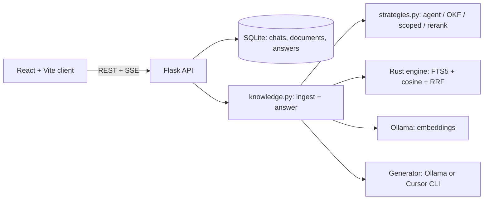

# Lookup

**How should an AI look things up in a long document?** Lookup is a chat app over your PDFs that answers with cited passages and puts five different search strategies behind the same interface, plus a benchmark that measures which one actually finds better evidence.

The test document is a 555-page CUDA textbook (*Programming Massively Parallel Processors*): code listings, formulas, cross-references and a deep table of contents. That's the kind of material where naive retrieval breaks.


## The experiment

Every RAG demo makes the same choice silently: chunk the PDF, embed it, take the top-k. Agents and long-context models have made other ways of looking things up practical, and they disagree with each other:

| Strategy | How it finds evidence | Model calls before answering |
| --- | --- | ---: |
| **RAG** | Hybrid search: BM25 (SQLite FTS5) + dense embeddings, fused by reciprocal rank | 0 |
| **Rerank** | Hybrid top-20, then the model keeps the five most relevant | 1 |
| **Scoped** | The model reads the table of contents and picks sections; hybrid search ranks only inside them | 1 |
| **OKF** | The model walks the book's outline ([Open Knowledge Format](https://github.com/GoogleCloudPlatform/open-knowledge-format) bundle) to sections, then passages. No vectors | 2 |
| **Agent** | LangGraph loop: plan a query → retrieve → judge sufficiency → rewrite once if needed | 2–4 |

To make the comparison fair, **only evidence acquisition varies**. All five share the generator, the answer prompt, a 3,072-token evidence budget, and a citation contract: the model may cite only the passage IDs it was given, or must say the document doesn't cover the question. Two controls bracket the results: *no retrieval* (the floor) and *gold evidence* (hand-annotated passages, the ceiling).

The question suite has 120 original questions in six types: factual, conceptual, multi-section synthesis, code/formula reading, follow-ups that depend on earlier turns, and unanswerable questions. Results are in [benchmarks/leaderboard.md](benchmarks/leaderboard.md) and [benchmarks/findings.md](benchmarks/findings.md). So far:

- Retrieval matters more than anything else: the same model goes from 6/24 to 21/24 correct once it gets evidence.
- One-shot RAG ties the LangGraph agent on accuracy at half the latency.
- In the retrieval run so far (35 of 100 questions), letting the model choose sections from the table of contents before searching (**Scoped**) finds the right passages more often than plain vector or hybrid search.

## Which models, and why

Search always runs locally: `embeddinggemma` for embeddings, SQLite + a Rust engine for BM25 and vectors. Generation is pluggable:

- **Local (default): `qwen3:4b` via Ollama.** It's free, private (a copyrighted book never leaves the laptop) and reproducible, since model digests are pinned in every benchmark run. A small model is also a deliberately hard test: it can't paper over bad retrieval with memorized knowledge. Its weakness is that it is now the bottleneck on hard questions, and it shouldn't grade its own answers.
- **Frontier models through your Cursor plan: `GENERATOR=cursor:<model>`.** Uses the [Cursor CLI's headless mode](https://cursor.com/docs/cli/headless) (`cursor-agent -p --output-format json`) to run any model your plan offers. Its output goes through the same citation validation. This sends each question and its selected passages to Cursor, so it is opt-in.

The benchmark keeps a separate journal per generator and judge, so you can answer "does a stronger model change which search strategy wins?" without mixing results. Model names are whatever your Cursor plan lists; the ones below are examples:

```sh
.venv/bin/python bench.py answers --generator ollama --judge cursor:claude-4.5-sonnet   # small model, strong judge
.venv/bin/python bench.py answers --generator cursor:gpt-5                              # frontier generator
.venv/bin/python bench.py report
```

## Using the app

- Streams as it works: agent steps ("Planned query…", "Evidence insufficient", "Rewrote query…"), then answer tokens, over server-sent events.
- Numbered citation chips open the exact passage with its page and section.
- **Compare methods** runs all five strategies on one question side by side, with timings, model calls and tokens.
- PDFs, embeddings and indexes live in `instance/`; nothing is uploaded anywhere unless you choose the Cursor generator.

## Architecture



- `web/`: React + TypeScript client built with Vite and served by Flask.
- `app.py`: API, CSRF and per-browser ownership; `POST /api/conversations/<id>/messages` streams `step`, `evidence`, `token`, then `done`.
- `knowledge.py`: PDF ingestion (outline-aware sections, tokenizer-exact 500-token chunks), generator backends, citation validation, comparisons.
- `strategies.py`: the five search strategies.
- `retrieval/`: Rust search engine with a versioned JSON protocol. Indexes are fingerprinted against source, embedding model and chunking, so a stale index is rejected rather than silently searched.
- `providers.py`: plain, ungrounded chat (offline demo, Ollama, or any OpenAI-compatible endpoint).
- `bench.py`: fast leaderboard. `evaluation.py`: slower frozen-protocol study with held-out split, repeats and bootstrap intervals.

## Run it

Prerequisites: Python 3.12+, Node 22, a Rust toolchain and [Ollama](https://ollama.com).

```sh
make setup     # Python venv, Rust engine, web client
make models    # pulls qwen3:4b + embeddinggemma and a pinned tokenizer
make dev       # http://127.0.0.1:5000
```

Click **Try GPU demo notes**, choose it as the source, and ask *"Can a barrier synchronize separate blocks?"*. Import any PDF from the library the same way. `make web-dev` runs Vite on :5173 against Flask for frontend work.

To answer with a frontier model instead, install the [Cursor CLI](https://cursor.com/docs/cli/overview), run `cursor-agent login` once, and set `GENERATOR=cursor:<model>` in `.env`.

With Docker (Ollama stays on the host for GPU access):

```sh
cp .env.example .env
docker compose up --build --wait
```

## Benchmarks

```sh
.venv/bin/python scripts/import_evaluation_corpus.py path/to/book.pdf
make bench
```

- **Retrieval track**: what each strategy hands the generator under the shared budget. Measures passage recall, gold-page hit rate, MRR, model calls and latency.
- **Answer track**: correctness (abstention rules, then an LLM judge against reference answers), citation precision, latency and tokens.

Runs are journaled per question and resume after interruption. Only aggregates are committed; the book, annotations and answers stay local.

## Tests

```sh
make test     # Rust + Python (API, strategies, streaming, Cursor backend) + web unit tests
make check    # ruff, mypy, rustfmt, clippy, TypeScript
RUN_BROWSER=1 .venv/bin/python -m pytest tests/test_browser.py   # Playwright end-to-end
```

Tests use deterministic fake models: no network, no API keys, no Cursor usage.

## Roadmap

[docs/roadmap.md](docs/roadmap.md): a tool-using search agent (grep / table of contents / search / read) to test whether agents need embeddings at all, an MCP server so other agents can search a book, a long-context "whole book in the prompt" baseline, and page-image retrieval for figures.
