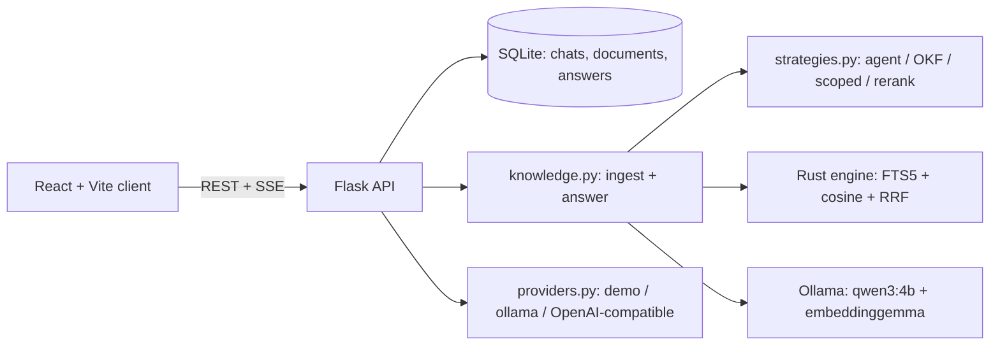

# Document Intelligence

Ask questions about a long PDF and get answers that cite the exact passages they came from, running entirely on your own machine. Five evidence-finding strategies, from one-shot hybrid RAG to a LangGraph agent and outline navigation, sit behind the same chat, and a benchmark harness measures which one actually finds better evidence.


## Highlights

- **Grounded, cited answers.** Every claim links to a numbered source chip; click it to read the passage with its page and section. The model can only cite passages it was given, or must say the document doesn't cover it.
- **Five search strategies, one interface.** Switch per question, or run all five side by side on the same question with timings, model calls and tokens.
- **Streams as it works.** Agent steps ("Planned query…", "Evidence insufficient", "Rewrote query…") and answer tokens arrive over server-sent events.
- **Private by default.** PDFs, embeddings and indexes stay in `instance/`; document answering only talks to a local Ollama.
- **Measured, not claimed.** A 120-question suite on a 555-page CUDA textbook with no-retrieval and gold-evidence controls ([leaderboard](benchmarks/leaderboard.md), [study](benchmarks/findings.md)).

## Search strategies

| Strategy | How it finds evidence | Model calls before answering |
| --- | --- | ---: |
| **RAG** | Hybrid search: BM25 (SQLite FTS5) + dense cosine, fused with reciprocal rank fusion | 0 |
| **Rerank** | Hybrid top-20, then the model keeps the five most relevant | 1 |
| **Scoped** | The model picks sections from the table of contents; hybrid search ranks only inside them | 1 |
| **OKF** | The model walks the document's outline (an [Open Knowledge Format](https://github.com/GoogleCloudPlatform/open-knowledge-format) bundle) to sections, then passages. No vectors | 2 |
| **Agent** | LangGraph loop: plan a query → retrieve → judge sufficiency → rewrite once if needed | 2–4 |

All five share the generator, the answer prompt, the citation schema and a 3,072-token evidence budget, so differences come from evidence acquisition alone.

## Architecture



- `web/`: React + TypeScript client built with Vite and served by Flask.
- `app.py`: API, CSRF and per-browser ownership; `POST /api/conversations/<id>/messages` streams `step`, `evidence`, `token`, then `done` events.
- `knowledge.py`: PDF ingestion (outline-aware sections, tokenizer-exact 500-token chunks), grounded answering, citation validation, comparisons.
- `strategies.py`: the agent, OKF, scoped and rerank strategies.
- `retrieval/`: Rust CLI with a versioned JSON protocol. Indexes are fingerprinted against the source, embedding model and chunking, so a stale index is rejected instead of silently searched.
- `providers.py`: ordinary (ungrounded) chat via the offline demo provider, Ollama, or any OpenAI-compatible endpoint.
- `bench.py`, `evaluation.py`: benchmark harnesses (see below).

## Run it

Prerequisites: Python 3.12+, Node 22, a Rust toolchain and [Ollama](https://ollama.com).

```sh
make setup     # Python venv, Rust engine, web client
make models    # pulls qwen3:4b + embeddinggemma and a pinned tokenizer
make dev       # http://127.0.0.1:5000
```

Click **Try GPU demo notes**, choose it as the source, and ask *"Can a barrier synchronize separate blocks?"*. Import any PDF from the library the same way. For frontend work, run `make web-dev` (Vite on :5173, proxied to Flask).

With Docker (Ollama still runs on the host for GPU access):

```sh
cp .env.example .env
docker compose up --build --wait
```

Set `CHAT_PROVIDER=ollama` in `.env` to use the local model for ordinary chat too; the default `demo` provider needs no model at all.

## Benchmarks

`bench.py` runs every strategy over the question suite and writes [`benchmarks/leaderboard.md`](benchmarks/leaderboard.md):

```sh
.venv/bin/python scripts/import_evaluation_corpus.py path/to/book.pdf
make bench    # retrieval track, development answer track, report
```

- **Retrieval track**: what each strategy hands the generator under the shared budget. Measures passage recall, gold-page hit rate, MRR, model calls and latency.
- **Answer track**: end-to-end correctness (abstention rules, then an LLM judge against reference answers), citation precision against annotated pages, latency and tokens.

`evaluation.py` is the slower frozen-protocol study behind [`benchmarks/findings.md`](benchmarks/findings.md): held-out split, repeated runs, bootstrap intervals and external QASPER / RAGBench probes.

## Tests

```sh
make test     # Rust + Python API/strategy/streaming tests + web unit tests
make check    # ruff, mypy, rustfmt, clippy, TypeScript
RUN_BROWSER=1 .venv/bin/python -m pytest tests/test_browser.py   # Playwright end-to-end
```

CI runs all of these plus a Docker build with a persistence smoke test. Tests use deterministic fake models; no network or API keys.

## Roadmap

[docs/roadmap.md](docs/roadmap.md) covers where this goes next: tool-using search agents, an MCP server so other agents can search a book, contextual chunk headers, cross-encoder reranking, long-context baselines and page-image retrieval for figures.
