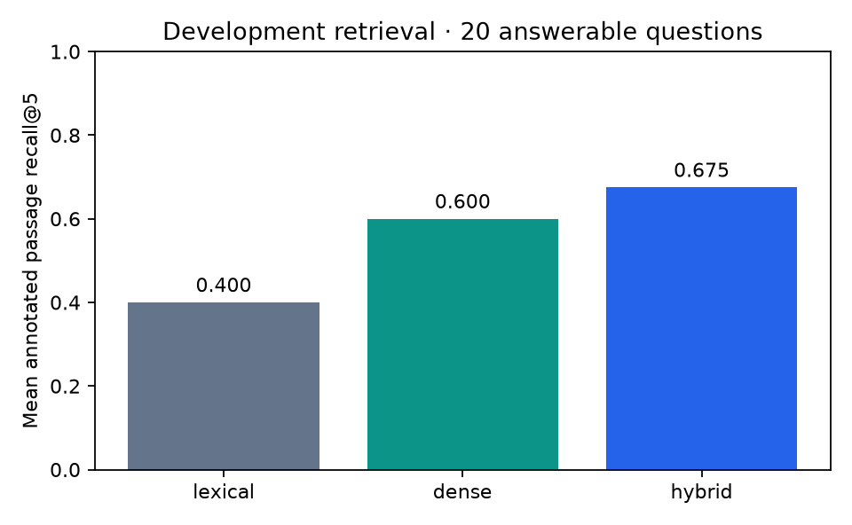
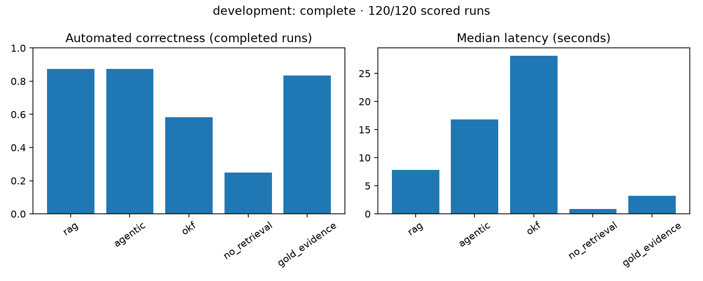

# Findings: development study

Corpus: *Programming Massively Parallel Processors* (4th ed.), 555 PDF pages, imported locally as 1,040
passages (500 tokens, 75 overlap) with a 15.5 MB SQLite index. Import takes about 66–76 seconds on an
Apple M4 / 16 GB with the models already loaded. The PDF and everything derived from it stay in
`instance/`; only aggregate numbers are published.

## Retrieval modes (20 answerable development questions)

| Mode | Passage recall@5 |
| --- | ---: |
| BM25 (SQLite FTS5) | 0.400 |
| Dense cosine (embeddinggemma) | 0.600 |
| Hybrid reciprocal-rank fusion | **0.675** |

Hybrid beats lexical by 0.275 (paired 95% bootstrap interval 0.10 to 0.48). Its lead over dense
(+0.075) is within noise at this sample size. Hybrid is the default for every search-based method.
Per-question values: `development-retrieval-ablation.json`; intervals: `retrieval-ablation-summary.json`.

## Answering methods (24 development questions, one run each)

Same generator (qwen3:4b, temperature 0, thinking off), prompt, citation schema and 3,072-token
evidence budget for every method.

| Method | Correct | Passage recall | Median latency | Model calls |
| --- | ---: | ---: | ---: | ---: |
| Standard RAG | **21/24** | 0.675 | **7.8 s** | 1.0 |
| Agentic RAG (LangGraph) | **21/24** | 0.650 | 16.8 s | 3.2 |
| OKF navigation (page-window index) | 14/24 | 0.150 | 28.1 s | 2.9 |
| No retrieval (control) | 6/24 | — | 0.8 s | 1.0 |
| Gold evidence (ceiling) | 20/24 | 1.000 | 3.2 s | 0.8 |

What this says:

- **Retrieval is doing the work.** The same model goes from 6/24 to 21/24 once it is given evidence,
  and RAG already matches the gold-evidence ceiling on this set.
- **The agent costs 2x latency for no gain here.** Agentic RAG tied plain RAG on correctness; its
  extra planning and sufficiency calls only pay off when the first query misses, which was rare.
- **OKF lost because of its index, not the idea.** This run navigated 33 fixed 32-passage windows
  whose titles were page ranges, so the model was choosing among near-identical labels (recall 0.15).
  The navigator now walks the book's real outline (chapter → section); see the leaderboard for the
  re-measured result.

Correctness uses deterministic rules first (unanswerable questions must abstain; answerable ones
must not; numeric answers are checked against the reference), then a local semantic judge.
Per-category scores, token counts and latency percentiles are in `development-summary.json` and
`development-aggregate.csv`.

## Still open

- Held-out split (96 questions × 5 conditions × 3 repeats) — the run was paused part-way.
- QASPER (50 papers) end-to-end probe and RAGBench (50 examples) judge calibration — samples are
  pinned (`*-sample-ids.json`, `external-provenance.json`) but not yet executed.
- A stratified 24-case manual audit (`audit-sample-ids.json`).
